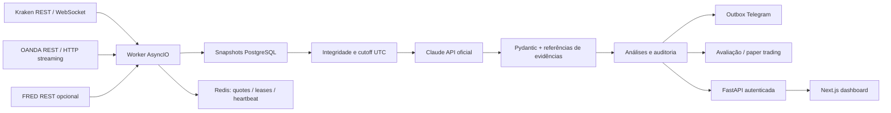

# Arquitetura da primeira versão

## Contratos

`Snapshot` representa o conjunto imutável recebido, incluindo provedor, candles fechados, cotação, trades e livro locais quando disponíveis, limitações e falhas. `Candle.volume_kind` diferencia REAL, TICK e UNAVAILABLE. A data de captura não substitui timestamps da fonte.

`Analysis` diferencia fatos, inferências e hipóteses. Exige os três cenários e os seis contextos temporais quando há dados suficientes. Zonas e evidências referenciam IDs do contexto fornecido; direção requer invalidação coerente com a referência e nenhuma informação obrigatória ausente.

O SDK Anthropic recebe uma ferramenta de **saída** `submit_analysis`. Não recebe credenciais no prompt nem ferramentas de execução. O backend monta o contexto; a IA não navega livremente nem faz consultas arbitrárias. Essa restrição mantém o fluxo auditável. O histórico curto inclui somente três análises anteriores do mesmo ativo e sem avaliações posteriores.

## Persistência e jobs

PostgreSQL: usuários, snapshots, análises, alertas, outbox, avaliações, paper trades e auditoria. As tabelas iniciam por `create_all` na v1. Redis: rate limiting, quotes efêmeras, heartbeat, locks globais para IA e outbox. A fila de notificações é a outbox transacional no PostgreSQL; Redis coordena o consumo. Não há fila de tarefas arbitrárias da IA.

Coleta REST a cada aproximadamente 60 segundos, interpretação a cada intervalo configurado, streaming independente com backoff e jitter. Preços de streaming mais novos podem substituir a cotação REST antes de persistir o snapshot. Uma falha de streaming usa a sincronização REST, sem fabricar dados.

O backend determina apenas integridade, orçamento, validade estrutural e entrega. Não converte indicadores em cenários. A invalidação numérica de um alerta compara preço observado com o nível previamente declarado pelo Claude; isso gerencia o estado de um cenário existente, não cria uma nova análise direcional.

## Segurança

Senha Argon2, cookie JWT HttpOnly/SameSite, origem validada em mutações, roles viewer/admin, rate limiting fechado em falha de Redis, chamadas externas TLS, logging de tipos de falha sem corpo/URLs secretas, frontend sem chaves, APIs de dados fixas e allowlist explícita de chats Telegram. Textos externos são tratados como dados não confiáveis no prompt. Sem ferramentas para negociação, shell ou leitura de segredos pela IA.

## Limites operacionais

Configuração não comprova conexão. Saúde da API verifica banco e Redis; worker tem heartbeat; dados possuem estado de atualidade e erros. Logs estruturados e API de métricas existem; não há exporter Prometheus nesta versão. Custos e reservas conservadoras são separados.

A avaliação v1 usa um horizonte predefinido e M1. Contexto multitemporal não implica seis estratégias testadas. Nenhum resultado é apresentado como negociação real ou validação estatística.
